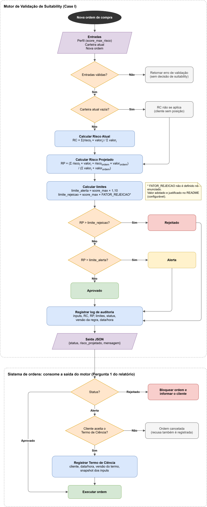

# Case Report: Motor de Validação de Suitability de Carteira

## 1. Visão geral da solução

Antes de qualquer nova compra, o motor responde a uma pergunta: se esta ordem for executada, a carteira do cliente continua adequada ao perfil dele? Para chegar a essa resposta, ele segue quatro passos:

1. Calcula o **risco atual da carteira**, que é a média do risco dos ativos ponderada pelo valor investido em cada um.
2. Calcula o **risco projetado**, ou seja, como a carteira ficaria se a compra acontecesse. Para isso, a nova ordem é tratada como mais um ativo da carteira e o mesmo cálculo é repetido.
3. Calcula os **limites do cliente** a partir do score máximo de risco do seu perfil.
4. Compara o risco projetado com esses limites e **classifica a ordem** como Aprovado, Alerta ou Rejeitado, devolvendo a decisão junto com os valores que a justificam.

As funções do motor apenas recebem dados e devolvem uma decisão: elas não leem arquivos, não acessam banco de dados e não dependem de rede. Por isso, a mesma lógica pode ser usada pela interface de linha de comando (`main.py`), por uma API ou por um processo automático, como o proposto na Pergunta 2.

### Premissas adotadas

O enunciado deixa alguns pontos em aberto. A seguir estão as decisões tomadas em cada um deles e o motivo de cada escolha.

- **Fórmula do risco da carteira:** No PDF, o denominador da fórmula do risco atual aparece vazio. Como se trata de uma média ponderada pelo valor investido, o denominador implementado é a soma dos valores investidos (Σ ValorInvestidoi). Assim, cada ativo influencia o resultado na proporção do dinheiro aplicado nele.

- **Limite de rejeição:** O enunciado define quando emitir um alerta (risco acima de 110% do score), mas não define a partir de quando a ordem deve ser rejeitada. Os exemplos dão uma pista: para um score de 2,5, o risco de 2,78 aparece como Alerta e o de 3,5 como Rejeitado. Logo, o limite de rejeição precisa estar acima de 2,78 e abaixo de 3,5, o que corresponde a algo entre 111,2% e 140% do score. Dentro dessa faixa, foi adotado 130% (fator 1,30). Esse valor segue a mesma lógica percentual da regra de alerta e deixa uma faixa intermediária, entre 110% e 130%, em que o cliente ainda pode seguir com a compra mediante o termo de ciência. O fator fica em `suitability/config.py` e pode ser alterado sem mexer na lógica do motor.

- **Significado de "ultrapassar":** A regra diz que o alerta acontece quando o risco ultrapassa o limite. Por isso, a comparação é estrita: um risco exatamente igual a 2,75 ainda não ultrapassou o limite e a ordem é aprovada.

- **Risco entre o score e o limite de alerta:** Um risco projetado de 2,6, por exemplo, está acima do score de 2,5, mas abaixo de 2,75. Como a regra só prevê alerta acima de 110% do score, essa faixa é tratada como tolerância e a ordem é aprovada.

- **Precisão dos cálculos:** Os cálculos usam o tipo `Decimal` em vez de `float`. De acordo com a documentação oficial do Python, o `float` representa os números em binário, e a maioria dos valores decimais, como 0,1, não tem representação exata nessa base. Isso gera pequenos erros nas contas, e perto de um limite esse erro pode mudar a decisão. A mesma documentação recomenda o módulo `decimal` para aplicações que exigem representação decimal exata, como as contábeis. Os testes incluem um caso em que o risco exato é 2,75 (aprovado), mas o cálculo em `float` resulta em 2,7500000000000004 e geraria um alerta indevido. Pelo mesmo motivo, a comparação com os limites usa o valor completo, e o arredondamento para duas casas decimais acontece apenas na resposta exibida.

- **Cliente sem carteira:** Um cliente novo ainda não tem ativos, então não existe risco atual a calcular (a fórmula dividiria por zero). Nesse caso, o risco atual é retornado como nulo e o risco projetado é o próprio risco do ativo que está sendo comprado.

- **Escala de risco:** O enunciado não informa qual é o valor máximo possível do score de risco de um ativo. Por isso, o motor recusa apenas valores negativos e não impõe um teto.

Para o perfil Moderado do enunciado (score 2,5), essas decisões resultam em três faixas: a ordem é aprovada até um risco projetado de 2,75, gera alerta acima de 2,75 até 3,25, e é rejeitada acima de 3,25.

---

## 2. Pergunta 1: Regulação vs. Negócio

> Se o cliente, ao receber o Alerta, insistir em prosseguir com a compra (o que é permitido pela CVM com um Termo de Ciência), quais são as implicações tecnológicas e de compliance que a Genial deve prever?

Quando o motor emite um alerta, o cliente pode decidir seguir com a compra mesmo assim. A Resolução CVM 30, que regula o dever das instituições de verificar se os produtos são adequados ao perfil do cliente, admite essa situação, mas com condições. De acordo com o seu art. 7, antes da primeira operação em uma categoria de ativo inadequada ao perfil, a instituição precisa alertar o cliente, indicando as causas da inadequação, e obter dele uma declaração expressa de que está ciente. O art. 14 determina ainda que esses documentos e declarações sejam guardados por no mínimo 5 anos.

Isso significa que aceitar o termo não é apenas um botão na tela. Para a Genial, cada aceite cria três responsabilidades: garantir que o cliente foi bem informado antes de decidir, registrar essa decisão de forma confiável e conseguir comprová-la anos depois.

Uma observação sobre o status Rejeitado: no enunciado, o termo de ciência aparece apenas na resposta de Alerta. Na resposta de Rejeitado, a mensagem diz que a operação viola a política de suitability, sem mencionar termo. Por isso, este relatório interpreta que uma ordem rejeitada é bloqueada e não pode ser liberada com a assinatura do termo. Essa é uma leitura da regra hipotética do case: a CVM 30, por si só, admite que o cliente opere fora do perfil desde que declare estar ciente.

### Implicações tecnológicas

Do ponto de vista técnico, o sistema precisa garantir que o cliente entendeu o alerta, que a decisão dele ficou registrada corretamente e que esse registro continua confiável ao longo do tempo.

**1. Mostrar ao cliente o motivo do alerta**

O art. 7 exige que o alerta indique as causas da inadequação. Uma mensagem genérica como "esta operação está fora do seu perfil" não é suficiente, porque o cliente não sabe o tamanho do problema nem o que o provocou. A tela de alerta deve mostrar, em linguagem simples, o risco atual da carteira, o risco depois da compra e o limite do perfil. Por exemplo: "Esta compra levará o risco da sua carteira de 1,67 para 2,83. O limite para o seu perfil é 2,75." O motor já devolve esses valores a cada validação, então a interface só precisa apresentá-los.

**2. Registrar o termo junto com os dados que geraram o alerta**

Cada aceite precisa ser registrado com a identificação do cliente e da ordem, a data e a hora, o canal usado (app, site ou assessor) e a versão do texto do termo que foi apresentado, já que esse texto pode mudar com o tempo.

Além disso, o registro deve guardar uma cópia dos dados usados na decisão: o perfil do cliente, a composição da carteira, a ordem, os riscos calculados, os limites e a versão da regra aplicada. Isso é necessário porque esses dados mudam. Daqui a um ano, os preços serão outros, o cliente pode ter refeito o perfil e a regra pode ter sido ajustada. Se o sistema guardar apenas "o cliente aceitou o termo em tal data", não será possível mostrar por que o alerta apareceu. Com a cópia dos dados, a decisão pode ser reconstruída exatamente como foi tomada.

**3. Executar a ordem somente depois que o termo estiver salvo**

Aceitar o termo e executar a ordem são duas etapas diferentes, e a ordem entre elas importa. Se a ordem fosse enviada primeiro e a gravação do termo falhasse (por uma queda de conexão, por exemplo), a Genial teria executado uma operação fora do perfil sem prova de que o cliente concordou. Por isso, o sistema primeiro grava o termo, confirma que a gravação deu certo e só então envia a ordem. Se a gravação falhar, a ordem não é enviada e o cliente é informado para tentar novamente.

O sistema também precisa evitar duplicidades. Se o cliente clicar duas vezes em "confirmar", ou se o app reenviar a solicitação depois de uma falha de rede, o sistema deve reconhecer que se trata da mesma ordem, usando um identificador único para cada uma, e não criar duas ordens nem dois termos.

**4. Validar a ordem novamente antes de executá-la**

Entre o momento em que o alerta aparece e o momento em que o cliente aceita o termo, podem se passar alguns minutos. Nesse intervalo, os preços mudam ou outra ordem do mesmo cliente pode ser executada, e o risco da carteira pode ter subido a ponto de a compra passar a ser rejeitada. Por isso, o motor deve ser executado mais uma vez logo antes do envio da ordem. Se o resultado continuar sendo Alerta, a compra segue com o termo assinado. Se passar a ser Rejeitado, a ordem é bloqueada e o cliente recebe a explicação.

Pelo mesmo motivo, cada termo deve valer apenas para a ordem em que foi aceito e por um tempo curto. Um termo aceito hoje não deve autorizar uma compra diferente na semana seguinte. A CVM exige a declaração antes da primeira operação em cada categoria de ativo; pedir um termo por ordem vai além dessa exigência, mas garante que cada operação tenha a sua própria evidência.

**5. Manter um histórico de auditoria que não pode ser alterado**

Todas as decisões do motor devem ser registradas, e não apenas os alertas: aprovações, alertas, rejeições, termos aceitos e termos recusados. Registrar também as aprovações é importante porque uma auditoria pode pedir para comprovar que uma ordem aprovada foi, de fato, validada.

Esse histórico não pode ser editado nem apagado, nem mesmo por administradores do sistema, porque um registro que pode ser alterado perde o valor como prova. Se for preciso corrigir alguma informação, a correção é feita com um novo registro que faz referência ao original. Assim, o histórico mostra tanto o que aconteceu quanto o que foi corrigido depois.

**6. Guardar os registros pelo prazo legal e proteger o acesso a eles**

Os termos e o histórico de decisões precisam ser mantidos por pelo menos 5 anos, conforme o art. 14. Como esses registros contêm dados pessoais e informações sobre o patrimônio dos clientes, o acesso deve ficar restrito às áreas que realmente precisam deles, como compliance e auditoria, e cada consulta deve ser registrada, em linha com a Lei Geral de Proteção de Dados (LGPD, Lei nº 13.709/2018).

**7. Identificar qual versão da regra foi aplicada em cada decisão**

As regras de suitability podem mudar. A Genial pode, por exemplo, reduzir a tolerância do alerta de 10% para 5%. Se o sistema não registrar qual regra estava valendo, uma decisão correta tomada com a regra antiga pode parecer errada quando analisada com a regra nova. Por isso, cada resposta do motor inclui o campo `versao_regra`, e toda alteração nos fatores de alerta ou de rejeição gera uma nova versão.

### Implicações de compliance

Para a área de compliance, esses registros não servem apenas para guardar provas. Eles também permitem acompanhar se a política de suitability está funcionando como deveria.

**1. Comprovar as decisões em uma fiscalização**

Se a CVM ou uma auditoria interna questionar uma operação feita há dois anos, o compliance precisa mostrar que o alerta foi exibido, quais eram os motivos, que o cliente aceitou o termo e quando isso aconteceu. Com os registros descritos acima, essa resposta sai diretamente do histórico, sem depender do estado atual do sistema ou da memória das pessoas envolvidas.

**2. Acompanhar clientes que assinam termos com frequência**

O termo de ciência existe para situações de exceção. Se um cliente assina termos toda semana, há duas explicações prováveis: o perfil dele não reflete mais os seus objetivos atuais, ou ele não está entendendo os alertas. Nos dois casos, esse comportamento deve ser sinalizado para que a Genial proponha uma revisão do perfil ou entre em contato com o cliente, evitando que o termo se torne uma formalidade.

**3. Medir como a política está sendo aplicada**

Relatórios periódicos com o número de alertas, de termos aceitos e recusados e de ordens rejeitadas, separados por perfil e por produto, mostram em quais situações os clientes mais recebem alertas e rejeições. Se um produto específico concentra muitos alertas, por exemplo, pode ser necessário revisar a classificação de risco dele ou a forma como é oferecido aos clientes.

**4. Supervisionar ordens feitas por meio de assessores**

Quando a ordem é registrada por um assessor, o termo identifica o profissional. Isso permite ao compliance verificar se algum assessor concentra muitas operações com termo de ciência, o que pode indicar que produtos inadequados ao perfil estão sendo recomendados, prática vedada pelo art. 6 da CVM 30.

Em resumo, aceitar o termo é uma decisão do cliente, mas cabe à Genial garantir que essa decisão foi informada, registrada e pode ser comprovada. O motor contribui para isso porque já devolve, a cada validação, os valores que explicam a decisão e a versão da regra utilizada.

---

## 3. Pergunta 2: Desenquadramento passivo

> Como o sistema da Genial poderia usar este motor para monitorar o desenquadramento passivo (quando o risco da carteira aumenta devido à volatilidade do mercado, sem nenhuma ação do cliente) e quais canais de comunicação (App, E-mail, Assessor) seriam mais eficazes para notificar o cliente?

O motor foi pensado para ser executado antes de uma compra, mas a carteira de um cliente pode sair do perfil mesmo sem nenhuma nova operação. Isso acontece porque o risco da carteira é uma média ponderada pelo valor de cada ativo, e esses valores mudam todos os dias com o mercado. Quando essa mudança leva o risco da carteira para além dos limites do perfil, ocorre o desenquadramento passivo. Há dois motivos principais para isso:

1. **Variação de preço dos ativos:** Quando um ativo de risco alto se valoriza, ele passa a representar uma parte maior da carteira e puxa a média para cima, mesmo que o cliente não tenha comprado nada.
2. **Mudança na classificação de risco de um ativo:** O score de risco de um produto pode ser revisto, por exemplo, se a empresa ou instituição responsável pelo ativo passar por dificuldades financeiras. Nesse caso, todas as carteiras que têm esse ativo têm o risco alterado ao mesmo tempo.

Para ilustrar o primeiro motivo, considere a carteira do enunciado: R$ 50.000 em CDB XPTO (risco 1,2) e R$ 10.000 em Ação ABC (risco 4,0), com risco atual de 1,67. Se a Ação ABC se valorizar até valer R$ 80.000, sem nenhuma compra, o risco da carteira passa a ser (1,2 × 50.000 + 4,0 × 80.000) / 130.000 ≈ 2,92. Esse valor está acima do limite de alerta de 2,75, e o cliente entrou em desenquadramento sem ter feito nada.

Para monitorar essa situação, a Genial pode reaproveitar o mesmo cálculo do motor. A diferença está no valor usado como peso de cada ativo: em vez do valor originalmente investido, entra o valor de mercado atual, que é o que representa a composição real da carteira naquele dia. Como não existe uma nova ordem, não há o que projetar. O risco calculado já é o risco da carteira e é comparado diretamente com os limites do perfil, usando as funções `calcular_risco()`, `calcular_limites()` e `classificar()`, que já existem no motor.

No dia a dia, esse monitoramento funcionaria assim. Todos os dias, depois do fechamento do mercado, um processo automático percorre as carteiras dos clientes. Esse horário é escolhido porque os preços de fechamento já estão definidos, então o cálculo reflete o resultado do dia. Para cada carteira, o processo atualiza o valor dos ativos com esses preços, calcula o risco e o classifica como Aprovado, Alerta ou Rejeitado. Como o cálculo de uma carteira não depende das outras, esse processamento pode ser dividido em várias execuções em paralelo à medida que o número de clientes cresce.

Em seguida, o resultado de cada carteira é comparado com o resultado do dia anterior, e o cliente só é notificado quando a situação piora, por exemplo, quando a carteira passa de Aprovado para Alerta. Se a carteira já estava em Alerta ontem e continua em Alerta hoje, uma nova notificação não traria nenhuma informação nova e acabaria fazendo o cliente se acostumar a ignorar os avisos.

Algumas mudanças não dependem do preço e não precisam esperar o processo diário. Quando o score de risco de um ativo é revisto, ou quando o cliente atualiza o seu perfil, as carteiras afetadas são recalculadas imediatamente.

Por fim, o risco de cada carteira é guardado diariamente. Esse histórico mostra quando o desenquadramento começou e como ele evoluiu, o que ajuda tanto a explicar a situação para o cliente quanto a responder a uma auditoria.

Vale destacar que o desenquadramento passivo não bloqueia operações nem obriga o cliente a vender ativos. O papel do sistema é avisar o cliente, explicar o que mudou e registrar que ele foi avisado. Se ele quiser fazer uma nova compra, ela passa normalmente pelo motor, que já leva em conta o risco atual da carteira.

### Canais de comunicação

Cada canal tem pontos fortes e limitações diferentes. Por isso, a forma mais eficaz de notificar o cliente não é escolher um único canal, e sim combiná-los de acordo com a gravidade da situação.

A tabela abaixo resume o que cada canal oferece, onde ele falha e, a partir disso, em que situação ele é mais útil.

| Canal | Pontos fortes | Limitações | Melhor uso |
|---|---|---|---|
| **App** (notificação e aviso na tela da carteira) | Chega ao cliente na hora, tem custo baixo e alcança todos os clientes. A notificação pode levar direto à tela da carteira, onde o cliente vê qual ativo causou o aumento do risco. | O cliente pode ter desativado as notificações ou não abrir o app com frequência, e o aviso pode se perder entre outras notificações. | Primeiro aviso, em qualquer nível de desenquadramento. |
| **E-mail** | Deixa um registro formal, que o cliente pode consultar depois e que serve como comprovante de que a comunicação foi feita. Comporta mais detalhes: composição da carteira, risco antes e depois da variação e opções disponíveis. | Costuma ser lido com atraso e pode ser filtrado como spam. | Complemento do aviso no app, com a explicação completa. |
| **Assessor** | Uma conversa permite explicar o contexto, tirar dúvidas e ajudar o cliente a decidir se vale a pena ajustar a carteira, mudando quanto está investido em cada ativo. É o canal com mais chance de o cliente realmente entender a situação. | Tem custo alto e não é viável para todos os clientes. Além disso, nem todo cliente tem assessor. | Situações mais graves, ou que continuam mesmo depois dos avisos automáticos. |

Comparando os três, o app e o e-mail se complementam: o app garante rapidez, e o e-mail garante o registro e o nível de detalhe. O assessor é o canal mais eficaz para que o cliente entenda o que está acontecendo, mas, por ser caro, faz mais sentido como reforço nos casos em que os avisos automáticos não são suficientes.

Essa combinação pode ser organizada como um escalonamento por severidade. Escalonar significa usar mais canais, e canais mais diretos, à medida que a situação fica mais grave. O objetivo é equilibrar alcance e custo: situações leves recebem avisos automáticos, e o contato humano fica reservado para quando ele faz diferença. Os níveis seriam três:

- **Quando a carteira entra na faixa de Alerta:** O risco passou da tolerância do perfil, mas ainda está na faixa intermediária. O cliente recebe uma notificação no app e um e-mail explicando o que mudou. Não há urgência, e a decisão de ajustar ou não a carteira é dele.

- **Quando a carteira entra na faixa de Rejeitado:** O risco está bem acima do perfil, no nível em que uma nova compra seria bloqueada. Além do app e do e-mail, o assessor do cliente entra em contato para explicar a situação e discutir as opções. Para clientes sem assessor, esse contato pode ser feito por um canal de atendimento.

- **Quando o Alerta persiste por muito tempo:** Se a carteira continua em Alerta por um período definido pela política da Genial e o cliente não reagiu aos avisos automáticos, é sinal de que eles não foram suficientes. Nesse caso, o contato passa a ser feito pelo assessor, como no nível anterior.

Em qualquer canal, a mensagem deve ser clara e sem termos técnicos: qual ativo causou o aumento, como está o risco em relação ao limite do perfil e quais são as opções do cliente (ajustar a carteira, revisar o perfil ou manter os investimentos como estão), sem pressioná-lo a vender. Cada notificação enviada é registrada no mesmo histórico de auditoria descrito na Pergunta 1, para que a Genial consiga comprovar que o cliente foi informado.

Dessa forma, o mesmo motor que valida as compras passa a acompanhar a carteira continuamente, e o cliente é avisado na medida certa: com frequência suficiente para não ser pego de surpresa, mas sem tantas notificações a ponto de deixar de prestar atenção nelas.

---

## Referências

- COMISSÃO DE VALORES MOBILIÁRIOS. **Resolução CVM nº 30, de 11 de maio de 2021**. Dispõe sobre o dever de verificação da adequação dos produtos, serviços e operações ao perfil do cliente. Texto consolidado, arts. 6, 7 e 14. Disponível em: https://conteudo.cvm.gov.br/export/sites/cvm/legislacao/resolucoes/anexos/001/resol030consolid.pdf
- BRASIL. **Lei nº 13.709, de 14 de agosto de 2018**. Lei Geral de Proteção de Dados Pessoais (LGPD). Disponível em: https://www.planalto.gov.br/ccivil_03/_ato2015-2018/2018/lei/l13709.htm
- PYTHON SOFTWARE FOUNDATION. **Floating-Point Arithmetic: Issues and Limitations**. Documentação oficial do Python 3. Disponível em: https://docs.python.org/3/tutorial/floatingpoint.html
